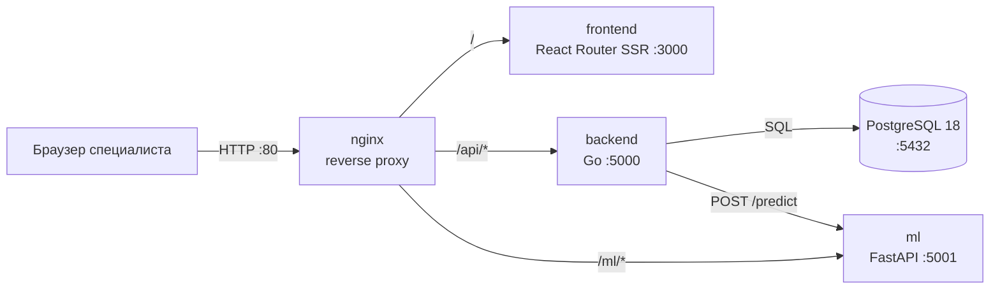
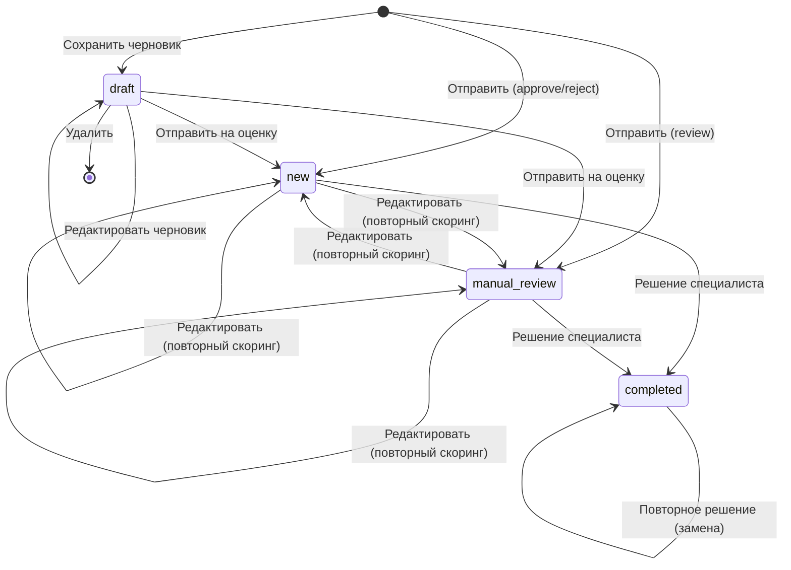

# Инструкция по эксплуатации сервиса «Кредитные решения» (credit-decision)

| Атрибут | Значение |
|---|---|
| Код системы | `credit-decision` |
| Тип документа | Инструкция по эксплуатации (Operations Manual / Runbook) |
| Версия документа | 1.0 |
| Версия системы | backend API 0.1.0, ML API 0.1.0 |
| Статус | Действующий |
| Дата | 07.11.2026 |
| Владелец системы | Команда разработки credit-decision |
| Ответственный за документ | Привалов К. (`hellkirl`) |

### История изменений

| Версия | Дата | Автор | Изменения |
|---|---|---|---|
| 1.0 | 07.11.2026 | Привалов К. | Первая редакция |

### Содержание

1. [Общие сведения](#1-общие-сведения)
2. [Архитектура](#2-архитектура)
3. [Требования к окружению](#3-требования-к-окружению)
4. [Конфигурация](#4-конфигурация)
5. [Развёртывание](#5-развёртывание)
6. [Штатная эксплуатация](#6-штатная-эксплуатация)
7. [Управление пользователями](#7-управление-пользователями)
8. [Резервное копирование и восстановление](#8-резервное-копирование-и-восстановление)
9. [Мониторинг и журналирование](#9-мониторинг-и-журналирование)
10. [Обновление системы](#10-обновление-системы)
11. [Сопровождение ML-модели](#11-сопровождение-ml-модели)
12. [Диагностика и устранение неисправностей](#12-диагностика-и-устранение-неисправностей)
13. [Управление инцидентами](#13-управление-инцидентами)
14. [Информационная безопасность](#14-информационная-безопасность)
15. [Известные ограничения](#15-известные-ограничения)
16. [Руководство пользователя (кредитного специалиста)](#16-руководство-пользователя-кредитного-специалиста)
17. [Приложения](#17-приложения)

---

## 1. Общие сведения

### 1.1. Назначение системы

Сервис «Кредитные решения» — внутренняя система банка для кредитных специалистов. Она позволяет:

- регистрировать кредитные заявки физических лиц (в том числе сохранять неполные заявки как черновики);
- автоматически оценивать вероятность дефолта заёмщика (PD) ML-моделью;
- получать рекомендацию системы: «Одобрить», «Проверить дополнительно», «Отклонить»;
- фиксировать окончательное решение специалиста с обоснованием;
- вести реестр заявок с поиском, фильтрами и сводной статистикой.

Система — инструмент **поддержки** принятия решений. Окончательное решение по заявке всегда принимает и фиксирует специалист.

### 1.2. Область действия документа

Документ описывает развёртывание, настройку, штатную эксплуатацию, резервное копирование, мониторинг, обновление и восстановление после сбоев. Раздел 16 — краткое руководство для конечных пользователей.

### 1.3. Целевая аудитория

| Роль | Разделы |
|---|---|
| Системный администратор / DevOps | 2–10, 12–14 |
| Дежурный инженер (L1/L2 поддержка) | 6, 9, 12, 13 |
| ML-инженер | 11, 15 |
| Специалист по ИБ | 14, 15 |
| Кредитный специалист | 16 |

### 1.4. Термины и сокращения

| Термин | Определение |
|---|---|
| Заявка | Кредитная заявка заёмщика, основной объект системы |
| Черновик | Заявка, сохранённая без полной валидации и без скоринга |
| PD (Probability of Default) | Вероятность дефолта, рассчитанная ML-моделью, от 0 до 1 |
| Скоринг | Оценка заявки ML-сервисом: PD, уровень риска, рекомендация |
| DM | Немецкая марка, валюта обучающего набора данных South German Credit |
| JWT | JSON Web Token, токен доступа пользователя |
| Seed-пользователь | Учётная запись, которую backend создаёт или обновляет при старте из переменных окружения |
| RPO / RTO | Допустимая потеря данных / допустимое время восстановления |

---

## 2. Архитектура

### 2.1. Компоненты



| Компонент | Технологии | Порт | Назначение | Хранит состояние |
|---|---|---|---|---|
| `nginx` | nginx 1.31.7 | 80 (опубликован на хосте) | Единая точка входа, маршрутизация по префиксу пути | Нет |
| `frontend` | Node 24, React 19, React Router 8 (SSR) | 3000 (внутренний) | Веб-интерфейс специалиста | Нет |
| `backend` | Go 1.27, Gin, GORM, JWT | 5000 (внутренний) | Бизнес-логика, аутентификация, хранение заявок | Нет (всё в БД) |
| `ml` | Python 3.11, FastAPI, scikit-learn | 5001 (внутренний) | Расчёт PD и рекомендации | Нет (модель в образе) |
| `db` | PostgreSQL 18.6 | 5432 (внутренний) | Пользователи и заявки | **Да**, том `db-data` |

Наружу опубликован только порт 80 контейнера `nginx`. Остальные сервисы доступны только внутри docker-сети `service-network`.

### 2.2. Маршрутизация nginx

| Префикс | Куда | Преобразование пути |
|---|---|---|
| `/api/*` | `backend:5000` | префикс `/api` отбрасывается |
| `/ml/*` | `ml:5001` | префикс `/ml` отбрасывается |
| `/` | `frontend:3000` | без изменений |

nginx определяет адреса сервисов через встроенный DNS Docker (`127.0.0.11`, кэш 30 с). Поэтому пересоздание контейнера за nginx не требует перезапуска nginx.

### 2.3. Порядок запуска и зависимости

```
db (healthy) → backend (healthy) ─┐
ml (healthy) ─────────────────────┼→ nginx
frontend (healthy) ───────────────┘
```

Все сервисы имеют политику `restart: unless-stopped` и `stop_grace_period: 30s`.

### 2.4. Поток обработки заявки

1. Специалист заполняет форму и нажимает «Отправить на оценку» (`POST /api/applications`, `draft: false`).
2. backend валидирует все поля (см. [Приложение Б](#приложение-б-правила-валидации-заявки)).
3. backend переводит данные в признаки модели (рубли пересчитываются в DM по курсу `RUB_PER_DM`, категории кодируются) и вызывает `POST http://ml:5001/predict` с таймаутом `ML_TIMEOUT`.
4. ML-сервис:
   - проверяет, что значения попадают в диапазоны обучающей выборки. Если нет, PD не рассчитывается и заявка уходит на ручную проверку с причиной `NUMERIC_OUT_OF_RANGE` или `UNSEEN_CATEGORY`;
   - рассчитывает PD (логистическая регрессия + калибровка Платта);
   - выдаёт решение: PD < 0,083 → `approve`; 0,083 ≤ PD ≤ 0,285 → `manual_review`; PD > 0,285 → `reject`;
   - если решение `reject`, а заёмщику 25 лет или меньше, решение меняется на `manual_review` (правило `YOUNG_APPLICANT_REVIEW`).
5. backend сохраняет PD, риск, рекомендацию и сработавшие правила. Статус: `manual_review` при рекомендации «Проверить дополнительно», иначе `new`.
6. Специалист изучает заявку и фиксирует решение (`POST /api/applications/{id}/decision`). Статус меняется на `completed`.

### 2.5. Жизненный цикл заявки



Правила переходов:

- удалить можно только черновик;
- отправленную заявку нельзя вернуть в черновик (HTTP 409);
- завершённую заявку (`completed`) нельзя редактировать (HTTP 409), но решение по ней можно перезаписать;
- по черновику нельзя принять решение (HTTP 409).

Статус `pending_confirmation` («На подтверждении») есть в схеме данных, но в текущей версии система его не присваивает.

---

## 3. Требования к окружению

### 3.1. Аппаратные требования (один хост)

| Ресурс | Минимум | Рекомендуется |
|---|---|---|
| CPU | 2 vCPU | 4 vCPU |
| RAM | 4 ГБ | 8 ГБ |
| Диск | 10 ГБ свободно | 20 ГБ SSD + место под резервные копии |
| Сеть | Входящий TCP 80 из сети пользователей | За корпоративным балансировщиком с TLS |

### 3.2. Программные требования

| ПО | Версия | Для чего |
|---|---|---|
| Docker Engine | 24+ | Запуск контейнеров |
| Docker Compose plugin | v2.20+ | Оркестрация (`docker compose`, не `docker-compose`) |
| git | любая актуальная | Получение кода |
| curl | любая | Проверки работоспособности |

Только для разработки и переобучения модели:

| ПО | Версия |
|---|---|
| Go | 1.27.1 |
| Node.js | 24 |
| Python | 3.11 |
| oapi-codegen | актуальная v2 |
| make | любая |

### 3.3. Сетевой доступ при сборке

При `docker compose build` нужен доступ к Docker Hub, `proxy.golang.org`, `registry.npmjs.org`, `pypi.org` и репозиториям Alpine/Debian. Во время работы внешний доступ не нужен.

---

## 4. Конфигурация

Конфигурация задаётся файлом `.env` в корне репозитория, который читает `docker compose`. Образец — `.env.example`. Файл `.env` исключён из git и **не должен** попадать в репозиторий.

### 4.1. Переменные окружения

| Переменная | Обяз. | По умолчанию | Описание |
|---|---|---|---|
| `JWT_SECRET` | **да** | — | Ключ подписи JWT (HS256), **не короче 32 символов**. Без него compose не запустится |
| `JWT_TTL` | нет | `8h` | Время жизни токена (формат Go: `30m`, `8h`, `24h`) |
| `POSTGRES_USER` | нет | `credit` | Пользователь БД |
| `POSTGRES_PASSWORD` | нет | `credit` | Пароль БД. **В продуктиве обязательно сменить** |
| `POSTGRES_DB` | нет | `credit` | Имя БД |
| `RUB_PER_DM` | нет | `49.1` (compose) / `100` (код) | Курс пересчёта суммы кредита из рублей в DM для модели. Должен быть > 0 |
| `APPROVE_THRESHOLD` | нет | `0.25` | Проверяется при старте (0…1), **но в текущей версии не влияет на скоринг** (см. раздел 15) |
| `ML_TIMEOUT` | нет | `5s` | Таймаут запроса backend → ML. **Не пробрасывается в compose** — чтобы задать, добавьте его в `environment` сервиса `backend` |
| `SEED_USER_LOGIN` | нет | пусто | Логин seed-пользователя. Пусто — пользователь не создаётся |
| `SEED_USER_PASSWORD` | если задан логин | пусто | Пароль seed-пользователя |
| `SEED_USER_FULL_NAME` | нет | `Иванов Иван Александрович` | ФИО для шапки интерфейса |
| `SEED_USER_POSITION` | нет | `Кредитный специалист` | Должность для шапки интерфейса |

Переменные, которые compose задаёт сам и менять не нужно: `HTTP_ADDR=:5000`, `DATABASE_URL`, `ML_URL=http://ml:5001`.

### 4.2. Проверка конфигурации при старте

backend проверяет конфигурацию до открытия порта и при ошибке завершает работу. Сообщение в логе:

```
FTL backend stopped error="config: JWT_SECRET must be at least 32 characters"
```

Проверяется:

- `DATABASE_URL` задан;
- `JWT_SECRET` не короче 32 символов;
- `JWT_TTL` и `ML_TIMEOUT` — корректные длительности;
- `RUB_PER_DM` > 0;
- `APPROVE_THRESHOLD` в диапазоне [0, 1];
- если задан `SEED_USER_LOGIN`, задан и `SEED_USER_PASSWORD`.

### 4.3. Генерация секретов

```bash
# JWT_SECRET (64 hex-символа)
openssl rand -hex 32

# Пароль БД
openssl rand -base64 24 | tr -d '/+='
```

> **Важно.** Смена `JWT_SECRET` сразу делает недействительными все выданные токены: все пользователи будут разлогинены. Смена `POSTGRES_PASSWORD` после первой инициализации тома **не меняет** пароль в уже созданной БД (см. 12.3).

---

## 5. Развёртывание

### 5.1. Первичная установка

```bash
# 1. Получить код
git clone <url-репозитория> credit-decision
cd credit-decision

# 2. Подготовить конфигурацию
cp .env.example .env
chmod 600 .env
# Отредактировать .env: JWT_SECRET, POSTGRES_PASSWORD, SEED_USER_*

# 3. Собрать образы
docker compose build

# 4. Запустить
docker compose up -d

# 5. Дождаться, пока все сервисы станут healthy (обычно до 1 минуты)
docker compose ps
```

Ожидаемый результат `docker compose ps`: у всех пяти сервисов статус `Up ... (healthy)`. У `nginx` нет healthcheck, его статус — `Up`.

### 5.2. Что происходит при первом запуске

1. PostgreSQL инициализирует кластер в томе `db-data`.
2. backend берёт advisory-блокировку и выполняет миграции: создаёт таблицы `users` и `applications` с индексами и ограничениями. Нумерация заявок начинается с **10001**.
3. backend создаёт seed-пользователя, если он задан в `.env`. В логе: `seed user ready login=<логин>`.
4. ML-сервис загружает модель, калибратор и метаданные из `/app/models`. Если какого-то файла нет, сервис не стартует (см. 12.5).

### 5.3. Приёмочная проверка (smoke test)

Выполнить после каждой установки и обновления.

```bash
# Точка входа и frontend
curl -fsS http://localhost/health

# backend через nginx
curl -fsS http://localhost/api/health
# {"status":"ok"}

# ML-сервис через nginx
curl -fsS http://localhost/ml/health
# {"status":"ok","model_loaded":true,"threshold":0.917}

# Аутентификация
TOKEN=$(curl -fsS -X POST http://localhost/api/auth/login \
  -H 'Content-Type: application/json' \
  -d '{"login":"<SEED_USER_LOGIN>","password":"<SEED_USER_PASSWORD>"}' \
  | sed -E 's/.*"access_token":"([^"]+)".*/\1/')

curl -fsS http://localhost/api/auth/me -H "Authorization: Bearer $TOKEN"

# Сквозной скоринг (создание заявки)
curl -fsS -X POST http://localhost/api/applications \
  -H "Authorization: Bearer $TOKEN" -H 'Content-Type: application/json' \
  -d @public/smoke-application.json
# {"id":10001}
```

Тело для `public/smoke-application.json` — в [Приложении В](#приложение-в-тестовая-заявка). Создавать тестовые заявки в продуктивной БД допускается только по согласованию; их нельзя удалить через API (удаляются только черновики). Лучше проверять сквозной сценарий черновиком (`"draft": true`) и затем удалять его, а полный скоринг проверять на тестовом стенде.

Проверка в браузере: открыть `http://<хост>/`, войти под seed-пользователем, убедиться, что открывается дашборд со статистикой.

---

## 6. Штатная эксплуатация

Все команды выполняются из корня репозитория.

### 6.1. Основные операции

| Операция | Команда |
|---|---|
| Запуск всех сервисов | `docker compose up -d` |
| Остановка (данные сохраняются) | `docker compose stop` |
| Остановка с удалением контейнеров (данные сохраняются) | `docker compose down` |
| Статус | `docker compose ps` |
| Перезапуск одного сервиса | `docker compose restart backend` |
| Применить изменения `.env` | `docker compose up -d` (пересоздаст изменённые сервисы) |
| Логи сервиса | `docker compose logs -f --tail=200 backend` |
| Потребление ресурсов | `docker stats` |

> **Опасно.** `docker compose down -v` удаляет тома, в том числе **базу данных**. Использовать только для полного сброса тестового стенда и только после резервного копирования.

### 6.2. Корректная остановка

При `SIGTERM` backend перестаёт принимать новые соединения и до 20 секунд дожидается завершения текущих запросов. Compose ждёт 30 секунд (`stop_grace_period`), потом отправляет `SIGKILL`. Для плановых работ:

1. Предупредить пользователей о работах (рекомендуется за 1 рабочий день).
2. `docker compose stop nginx` — закрыть вход пользователям.
3. Сделать резервную копию БД (раздел 8).
4. `docker compose stop`.

### 6.3. Регламентные работы

| Периодичность | Работа | Ответственный |
|---|---|---|
| Ежедневно | Проверить `docker compose ps`, что все сервисы healthy | Дежурный инженер |
| Ежедневно | Резервная копия БД (автоматически, см. 8.2) и проверка, что она создана | Администратор |
| Еженедельно | Просмотреть логи backend на ошибки уровня `ERR` | Дежурный инженер |
| Еженедельно | Проверить свободное место на диске (`df -h`, `docker system df`) | Администратор |
| Ежемесячно | Тестовое восстановление из резервной копии на стенде | Администратор |
| Ежемесячно | Очистить неиспользуемые образы: `docker image prune` | Администратор |
| Ежеквартально | Обновить базовые образы и зависимости (раздел 10) | Разработка |
| Ежеквартально | Ротация `JWT_SECRET` и паролей | Администратор + ИБ |
| Ежеквартально | Анализ качества модели (раздел 11.4) | ML-инженер |

---

## 7. Управление пользователями

В текущей версии нет интерфейса администрирования пользователей и ролей: все пользователи имеют одинаковые права. Пользователями управляет администратор одним из двух способов.

### 7.1. Через seed-механизм (рекомендуется)

При каждом старте backend выполняет upsert пользователя из `SEED_USER_*`: создаёт, если логина нет (без учёта регистра), или обновляет пароль, ФИО и должность, если логин есть. Ранее созданные пользователи **не удаляются**.

Добавить пользователя:

```bash
# В .env
SEED_USER_LOGIN=petr.petrov
SEED_USER_PASSWORD=<временный пароль>
SEED_USER_FULL_NAME=Петров Пётр Петрович
SEED_USER_POSITION=Ведущий кредитный специалист

docker compose up -d backend
docker compose logs backend | grep "seed user ready"
```

Сбросить пароль: так же, указав существующий логин и новый пароль.

После операции рекомендуется очистить `SEED_USER_PASSWORD` в `.env`, чтобы пароль не хранился в открытом виде, или вернуть туда значения основного служебного пользователя. **Внимание:** при каждом перезапуске backend пароль seed-пользователя перезаписывается значением из `.env`.

### 7.2. Через SQL (просмотр, блокировка, удаление)

```bash
docker compose exec db psql -U credit -d credit
```

```sql
-- Список пользователей
SELECT id, login, full_name, position, created_at FROM users ORDER BY id;

-- Заблокировать вход: заменить хэш на невалидный (пароль подобрать будет невозможно)
UPDATE users SET password_hash = '!disabled' WHERE lower(login) = lower('petr.petrov');
```

Удалять пользователей, на которых ссылаются заявки (`created_by`, `decided_by`), не рекомендуется: это ломает аудит. Блокируйте их, как показано выше.

> Ранее выданный токен заблокированного пользователя остаётся действительным до истечения `JWT_TTL`. Чтобы отозвать доступ сразу, смените `JWT_SECRET` (разлогинит всех).

---

## 8. Резервное копирование и восстановление

### 8.1. Что резервировать

| Объект | Где | Способ | Критичность |
|---|---|---|---|
| БД PostgreSQL | том `db-data` | `pg_dump` | **Критично** — единственное хранилище бизнес-данных |
| Конфигурация | `.env` | копия файла в защищённое хранилище секретов | Высокая |
| Код, модель, конфиги nginx | git-репозиторий | git | Восстанавливается из репозитория |

Целевые показатели: **RPO ≤ 24 ч** (ежедневная копия), **RTO ≤ 1 ч**.

### 8.2. Создание резервной копии

```bash
mkdir -p backups
docker compose exec -T db pg_dump -U credit -d credit -Fc \
  > backups/credit_$(date +%Y%m%d_%H%M%S).dump

# Проверка, что копия читается
docker compose exec -T db pg_restore --list < backups/credit_<дата>.dump | head
```

Автоматизация через cron на хосте (ежедневно в 02:00, хранение 30 дней):

```cron
0 2 * * * cd /opt/credit-decision && docker compose exec -T db pg_dump -U credit -d credit -Fc > backups/credit_$(date +\%Y\%m\%d).dump && find backups -name 'credit_*.dump' -mtime +30 -delete
```

Резервные копии содержат персональные данные заёмщиков. Их нужно хранить вне хоста, в зашифрованном виде и с ограниченным доступом.

### 8.3. Восстановление

```bash
# 1. Закрыть доступ пользователям и остановить backend
docker compose stop nginx backend

# 2. Восстановить (существующие объекты будут удалены и созданы заново)
docker compose exec -T db pg_restore -U credit -d credit --clean --if-exists \
  < backups/credit_<дата>.dump

# 3. Запустить backend (миграции выровняют схему и счётчик ID) и nginx
docker compose up -d backend nginx

# 4. Выполнить smoke test (раздел 5.3)
```

### 8.4. Полное восстановление на новом хосте

1. Установить Docker (раздел 3).
2. Получить код из git и нужный тег/коммит.
3. Восстановить `.env` из хранилища секретов.
4. `docker compose build && docker compose up -d db`.
5. Дождаться healthy и выполнить шаг 2 из 8.3.
6. `docker compose up -d`, выполнить smoke test.

---

## 9. Мониторинг и журналирование

### 9.1. Проверки работоспособности

| Сервис | Внутренняя проверка (healthcheck) | Внешняя проверка через nginx |
|---|---|---|
| backend | `curl -f http://localhost:5000/health` | `GET /api/health` → `{"status":"ok"}` |
| ml | `curl -f http://localhost:5001/health` | `GET /ml/health` → `model_loaded: true` |
| frontend | `wget -qO- http://localhost:3000/health` | `GET /health` |
| db | `pg_isready` | — |

Интервал healthcheck — 5 с, сервис считается unhealthy после 5 неудачных проверок подряд.

> `GET /api/health` у backend проверяет только сам процесс, **не** доступность БД и ML-сервиса. Для полноценного мониторинга нужна синтетическая проверка `GET /api/applications/stats` с токеном (проверяет БД) и `GET /ml/health` (проверяет модель).

### 9.2. Рекомендуемые оповещения

| Условие | Приоритет | Действие |
|---|---|---|
| `/api/health` или `/ml/health` не отвечает > 1 мин | P1 | Раздел 12 |
| `model_loaded: false` | P1 | 12.5 |
| Контейнер в статусе `unhealthy` или `restarting` | P2 | `docker compose logs <сервис>` |
| Доля ответов 5xx backend > 1 % за 5 мин | P2 | 12.4 |
| Свободно < 15 % на диске | P2 | Очистка логов и образов, расширение диска |
| Резервная копия за прошедшие сутки отсутствует | P3 | 8.2 |

### 9.3. Журналы

| Сервис | Формат | Содержимое |
|---|---|---|
| backend | zerolog, человекочитаемый, stderr | Строка на каждый HTTP-запрос: метод, путь, статус, длительность; ошибки — уровень `ERR` с полем `error`. Медленные SQL-запросы (> 200 мс) пишет GORM |
| ml | uvicorn access log | Запросы к ML API, трассировки исключений |
| frontend | react-router-serve | Запросы SSR |
| nginx | combined (`main`) | access/error log внутри контейнера |
| db | стандартный PostgreSQL | Ошибки подключения, контрольные точки |

Пример строки backend:

```
2026-11-07T10:24:01Z INF request duration=48.2ms method=POST path=/applications status=201
2026-11-07T10:25:13Z ERR request duration=5.0s error="score application: ml predict: ... context deadline exceeded" method=POST path=/applications status=500
```

Просмотр:

```bash
docker compose logs -f backend                      # поток
docker compose logs --since 1h backend | grep ERR   # ошибки за час
docker compose logs --since 24h nginx | awk '$9 ~ /^5/' | wc -l   # число 5xx за сутки
```

**Ротация.** По умолчанию драйвер `json-file` не ограничивает размер логов. Ограничьте его в `/etc/docker/daemon.json` и перезапустите Docker:

```json
{ "log-driver": "json-file", "log-opts": { "max-size": "50m", "max-file": "5" } }
```

### 9.4. Бизнес-метрики

```sql
-- Распределение заявок по статусам
SELECT status, count(*) FROM applications GROUP BY status;

-- Доля рекомендаций за последние 7 дней
SELECT recommendation, count(*) FROM applications
WHERE created_at > now() - interval '7 days' AND status <> 'draft'
GROUP BY recommendation;

-- Расхождение рекомендации системы и решения специалиста
SELECT recommendation, decision, count(*) FROM applications
WHERE status = 'completed' GROUP BY 1, 2 ORDER BY 1, 2;

-- Заявки, ушедшие на ручную проверку из-за выхода за границы модели
SELECT id, triggered_rules FROM applications
WHERE default_probability IS NULL AND status <> 'draft';
```

Резкий рост доли `review` или `reject`, а также доли заявок без PD — признак дрейфа данных или неверного `RUB_PER_DM` (раздел 11).

---

## 10. Обновление системы

### 10.1. Стандартная процедура обновления

```bash
# 0. Резервная копия БД (раздел 8.2) — обязательно

# 1. Получить новую версию
git fetch && git checkout <тег-или-коммит>

# 2. Сверить .env.example с .env — добавить новые переменные
diff <(sed 's/=.*//' .env.example | sort) <(sed 's/=.*//' .env | sort)

# 3. Собрать образы
docker compose build

# 4. Применить (пересоздаются только изменённые сервисы)
docker compose up -d

# 5. Smoke test (раздел 5.3)
```

Миграции схемы БД backend выполняет автоматически при старте (GORM AutoMigrate под advisory-блокировкой). AutoMigrate только **добавляет** таблицы, колонки и индексы: колонки он не удаляет и типы не меняет. Деструктивные изменения схемы требуют отдельного SQL-скрипта и указываются в описании релиза.

### 10.2. Откат

```bash
git checkout <предыдущий-тег>
docker compose build && docker compose up -d
```

Если новая версия изменила схему БД несовместимо, восстановите БД из копии, сделанной на шаге 0 (раздел 8.3).

### 10.3. Обновление API-контрактов (для разработки)

Контракты описаны в OpenAPI, клиентский и серверный код генерируется:

| Файл | Назначение |
|---|---|
| `backend/api/openapi/openapi.yaml` | Контракт backend ↔ frontend (источник истины) |
| `backend/api/openapi/ml.json` | Контракт backend ↔ ML (выгружается из FastAPI) |

```bash
make ml-openapi   # выгрузить свежую схему ML API (нужен ml/venv)
make generate     # сгенерировать Go-сервер, Go-клиент ML и TS-типы frontend
```

После генерации пересоберите затронутые образы.

### 10.4. Обновление базовых образов

Версии зафиксированы: `nginx:1.31.7`, `postgres:18.6`, `golang:1.27.1-alpine`, `alpine:3.22`, `python:3.11-slim`, `node:24-alpine`. Мажорное обновление PostgreSQL (например, 18 → 19) **несовместимо** с существующим томом: только через `pg_dump` → новый том → `pg_restore`.

---

## 11. Сопровождение ML-модели

### 11.1. Состав модели

| Артефакт | Путь | Назначение |
|---|---|---|
| Модель | `ml/models/logistic_regression.joblib` | Пайплайн sklearn: предобработка + логистическая регрессия |
| Калибратор | `ml/models/platt_calibrator.joblib` | Калибровка Платта, переводит выход модели в PD |
| Метаданные | `ml/models/training_metadata.json` | Допустимые диапазоны и категории признаков (по обучающей выборке) |
| Отчёты | `ml/reports/metrics.json`, `classification_report.txt`, `coefficients.csv`, `figures/` | Качество модели |
| Данные | `ml/data/raw/SouthGermanCredit.asc` | Набор данных South German Credit (1000 записей) |

Артефакты **встраиваются в образ** при сборке (`COPY models ./models`). Новая модель вступает в силу только после пересборки образа `ml`.

### 11.2. Текущие показатели качества (тестовая выборка, 200 записей)

| Метрика | Значение |
|---|---|
| ROC AUC | 0,837 |
| Accuracy | 0,765 |
| Precision (класс «хороший») | 0,897 |
| Recall (класс «хороший») | 0,750 |
| F1 | 0,817 |

### 11.3. Бизнес-пороги

| Порог | Значение | Где задан |
|---|---|---|
| Одобрение: PD < | 0,083 | `ml/src/credit/api.py` (`APPROVE_PD_THRESHOLD`) и `backend/internal/application/commands/create_application.go` |
| Отказ: PD > | 0,285 | `ml/src/credit/api.py` (`REJECT_PD_THRESHOLD`) и там же в backend |
| Возраст для защиты от автоотказа | ≤ 25 лет | `ml/src/credit/api.py` |

Пороги продублированы в двух сервисах. При изменении их нужно править **синхронно** в обоих местах: ML определяет рекомендацию, а backend — уровень риска и пороги, которые показываются в карточке заявки. Изменение порогов — изменение кредитной политики, его согласовывает риск-менеджмент.

### 11.4. Переобучение модели

```bash
cd ml
python3.11 -m venv venv && source venv/bin/activate
pip install -r requirements.txt

python scripts/train.py      # обучает модель, калибратор, пишет метаданные и отчёты
python scripts/serve.py      # локальная проверка на http://localhost:8000/docs
```

Порядок вывода новой модели в эксплуатацию:

1. Сравнить новые `reports/metrics.json` с текущими (раздел 11.2). ROC AUC не должен снизиться.
2. Закоммитить артефакты в git отдельным коммитом с описанием изменений.
3. Если изменилась схема запроса или ответа — `make ml-openapi && make generate`.
4. `docker compose build ml && docker compose up -d ml`.
5. Проверить `GET /ml/health` (`model_loaded: true`) и `GET /ml/metrics`.
6. В течение недели отслеживать распределение рекомендаций (раздел 9.4).

### 11.5. Курс пересчёта `RUB_PER_DM`

Модель обучена на суммах в DM. backend переводит рублёвую сумму делением на `RUB_PER_DM`. Допустимый диапазон суммы по метаданным модели — 250…15 945 DM, то есть при курсе 49,1 примерно **12 300 … 783 000 ₽**. Заявки вне диапазона **не получают PD** и уходят на ручную проверку с причиной `NUMERIC_OUT_OF_RANGE: amount`. Аналогично срок ограничен 4…60 месяцами, возраст — 19…75 годами.

Изменение `RUB_PER_DM` напрямую меняет результаты скоринга и согласовывается с риск-менеджментом.

### 11.6. Документация ML API

Swagger UI ML-сервиса: `http://<хост>/ml/docs`; метрики: `GET /ml/metrics`.

---

## 12. Диагностика и устранение неисправностей

### 12.1. Общий алгоритм

1. `docker compose ps` — какой сервис не в статусе healthy?
2. `docker compose logs --tail=100 <сервис>` — какая ошибка?
3. Найти симптом в таблице 12.2.
4. Если не решено за 30 минут — эскалация по разделу 13.

### 12.2. Типовые неисправности

| Симптом | Вероятная причина | Решение |
|---|---|---|
| `docker compose up` падает с `set JWT_SECRET (at least 32 characters) in .env` | Нет `.env` или в нём нет `JWT_SECRET` | Создать `.env` (раздел 5.1) |
| backend перезапускается, в логе `config: ...` | Ошибка конфигурации | Исправить переменную по тексту ошибки (4.2) |
| backend: `open database` / `connection refused` | БД не запущена или недоступна | `docker compose ps db`, логи db |
| backend: `password authentication failed` | Пароль в `.env` не совпадает с паролем в томе | 12.3 |
| nginx не стартует, ждёт зависимости | Один из сервисов не стал healthy | Найти unhealthy-сервис и разобраться с ним |
| В браузере `502 Bad Gateway` | Целевой сервис упал или пересоздаётся | `docker compose ps`, логи сервиса; после пересоздания подождать до 30 с (DNS-кэш nginx) |
| Создание заявки → HTTP 500, в логе `ml predict: ... deadline exceeded` или `connection refused` | ML-сервис недоступен или перегружен | 12.4 |
| Создание заявки → 500, `ml predict: status 422` | Расхождение контракта backend ↔ ML | Сверить версии образов, `make ml-openapi && make generate`, пересобрать |
| ML не стартует: `Required scoring artifacts are missing` | В образе нет файлов модели | 12.5 |
| Вход → 401 «invalid login or password» | Неверный пароль или пользователь не создан | Проверить пользователя (7.2), сбросить пароль (7.1) |
| Пользователей массово выбрасывает на страницу входа | Сменился `JWT_SECRET` или истёк `JWT_TTL` | Ожидаемое поведение; перелогиниться |
| Все заявки уходят на ручную проверку с `NUMERIC_OUT_OF_RANGE: amount` | Неверный `RUB_PER_DM` или суммы вне диапазона модели | Проверить `RUB_PER_DM` (11.5) |
| Все заявки с целью «Образование» — на ручной проверке, `UNSEEN_CATEGORY: purpose` | Известное ограничение модели | Раздел 15 |
| Редактирование → 409 | Заявка завершена или попытка вернуть отправленную заявку в черновик | Ожидаемое поведение (2.5) |
| Удаление → 409 «only drafts can be deleted» | Попытка удалить не черновик | Ожидаемое поведение |
| Нехватка диска | Логи Docker, старые образы, резервные копии | `docker system df`, `docker image prune`, ротация логов (9.3) |

### 12.3. Несовпадение пароля БД

Переменная `POSTGRES_PASSWORD` применяется только при **первой** инициализации тома. Чтобы сменить пароль на работающей БД:

```bash
docker compose exec db psql -U credit -d credit -c "ALTER USER credit WITH PASSWORD '<новый пароль>';"
# Затем обновить POSTGRES_PASSWORD в .env
docker compose up -d backend
```

### 12.4. ML-сервис недоступен или отвечает медленно

Пока ML-сервис недоступен, **новые заявки нельзя отправить на оценку и отправленные нельзя отредактировать** (HTTP 500). Сохранение черновиков, просмотр и принятие решений по уже оценённым заявкам работают.

```bash
docker compose ps ml
docker compose logs --tail=200 ml
docker compose exec backend curl -s http://ml:5001/health
docker compose restart ml
```

Если ML медленный под нагрузкой, увеличьте `ML_TIMEOUT` (не забудьте добавить его в `environment` backend в compose) или число воркеров uvicorn (`--workers N` в `ml/Dockerfile`).

Временная мера для пользователей — сохранять заявки как черновики и отправить их на оценку после восстановления сервиса.

### 12.5. Отсутствуют артефакты модели

```bash
docker compose run --rm ml ls -la /app/models
git status ml/models    # файлы должны быть в репозитории
```

Восстановить файлы из git (`git checkout -- ml/models`) или переобучить модель (11.4), затем `docker compose build ml && docker compose up -d ml`.

### 12.6. Прямой доступ к внутренним сервисам

Порты backend, ml и db не опубликованы на хосте. Для диагностики:

```bash
docker compose exec backend curl -s http://localhost:5000/health
docker compose exec backend curl -s http://ml:5001/health
docker compose exec db psql -U credit -d credit
```

---

## 13. Управление инцидентами

### 13.1. Классификация

| Приоритет | Критерий | Пример | Время реакции | Целевое время восстановления |
|---|---|---|---|---|
| P1 — Критический | Сервис недоступен всем пользователям или есть риск потери/утечки данных | БД не стартует, nginx недоступен, утечка `.env` | 15 мин | 1 ч |
| P2 — Высокий | Ключевая функция недоступна, обходной путь есть | ML недоступен — работают только черновики | 30 мин | 4 ч |
| P3 — Средний | Частичная деградация | Медленные ответы, ошибки у части запросов | 4 ч | 2 рабочих дня |
| P4 — Низкий | Косметические ошибки, вопросы | Опечатка в интерфейсе | 1 рабочий день | По плану релизов |

### 13.2. Порядок действий дежурного

1. **Зафиксировать** инцидент: время обнаружения, симптомы, затронутые пользователи.
2. **Оценить** приоритет по 13.1.
3. **Оповестить** пользователей (P1/P2) о недоступности и обходном пути.
4. **Стабилизировать**: перезапустить сервис, откатить версию (10.2), восстановить из копии (8.3).
5. **Эскалировать** разработке, если стабилизировать не удалось за 30 минут (P1/P2).
6. **Закрыть** инцидент после smoke test (5.3) и подтверждения от пользователей.
7. Для P1/P2 в течение 3 рабочих дней провести **разбор (postmortem)**: хронология, первопричина, корректирующие действия. Без поиска виноватых.

### 13.3. Сбор диагностической информации для эскалации

```bash
{
  date; git rev-parse HEAD
  docker compose ps
  docker compose logs --since 1h --no-color
} > incident_$(date +%Y%m%d_%H%M%S).log 2>&1
```

Перед передачей убедитесь, что в файле нет паролей и токенов. Файл `.env` не прикладывать.

---

## 14. Информационная безопасность

### 14.1. Обрабатываемые данные

Система обрабатывает **персональные данные** заёмщиков (ФИО, возраст, семейное положение, сведения о занятости и финансах) и сведения, составляющие банковскую тайну. Требования 152-ФЗ и внутренние политики банка распространяются на БД, резервные копии и логи.

### 14.2. Реализованные меры

| Мера | Реализация |
|---|---|
| Аутентификация | Логин/пароль, JWT HS256 со сроком действия; все эндпоинты, кроме `/health` и `/auth/login`, требуют токен |
| Хранение паролей | bcrypt (cost 10) |
| Поиск логина | Без учёта регистра, уникальный индекс по `lower(login)` |
| Целостность данных | CHECK-ограничения БД на статусы, риски, рекомендации и согласованность полей решения |
| Изоляция сети | Наружу опубликован только порт 80; БД, backend и ML — во внутренней сети |
| Контейнеры | backend запускается от непривилегированного пользователя (UID 10001) |
| Секреты | `.env` исключён из git |
| Аудит действий | В заявке сохраняются автор (`created_by`), автор решения (`decided_by`) и время решения |

### 14.3. Обязательные требования для продуктивной среды

1. **TLS.** Сервис работает по HTTP. Разместите его за корпоративным балансировщиком или reverse proxy с HTTPS либо добавьте TLS в `nginx/conf.d/default.conf`. Без TLS пароли и токены передаются открыто.
2. **Закрыть `/ml/`.** ML API опубликован через nginx **без аутентификации** (`/ml/docs`, `/ml/predict`). В продуктиве удалите блок `location /ml/` из `nginx/conf.d/default.conf` или ограничьте его (`allow`/`deny` по IP). backend обращается к ML напрямую по внутренней сети, так что пользователи это не заметят.
3. Сменить все значения по умолчанию: `POSTGRES_PASSWORD`, `JWT_SECRET`, `SEED_USER_PASSWORD`.
4. Права на `.env` — `600`, владелец — служебная учётная запись.
5. Ограничить доступ к порту 80 сетью пользователей (межсетевой экран).
6. Шифровать резервные копии и хранить их отдельно от хоста.
7. Ротация секретов — не реже раза в квартал и сразу при подозрении на компрометацию.

### 14.4. Действия при компрометации

| Что скомпрометировано | Действие |
|---|---|
| `JWT_SECRET` | Сгенерировать новый, `docker compose up -d backend` (все сессии сбросятся) |
| Пароль пользователя | Сбросить (7.1) и сменить `JWT_SECRET` |
| Пароль БД | Сменить (12.3) |
| Резервная копия / дамп | Инцидент P1, уведомить службу ИБ |

---

## 15. Известные ограничения

| № | Ограничение | Влияние | Обходной путь / план |
|---|---|---|---|
| 1 | Переменная `APPROVE_THRESHOLD` проверяется при старте, но не используется. Пороги 0,083 / 0,285 зашиты в коде ML и backend | Изменение переменной не влияет на скоринг | Менять пороги в коде (11.3) |
| 2 | Цель кредита «Образование» (`education`, код 7) не встречалась в обучающей выборке | Такие заявки всегда идут на ручную проверку с `UNSEEN_CATEGORY: purpose` | Ручная проверка; переобучить модель на данных с этой категорией |
| 3 | Суммы, сроки и возраст за пределами обучающей выборки (11.5) не оцениваются | Ручная проверка с `NUMERIC_OUT_OF_RANGE` | Ожидаемое поведение, защита от экстраполяции модели |
| 4 | Нет ролевой модели и интерфейса администрирования пользователей | Все пользователи равноправны; управление — через `.env`/SQL | Раздел 7 |
| 5 | Нет отзыва отдельного токена | Заблокированный пользователь работает до истечения `JWT_TTL` | Смена `JWT_SECRET` |
| 6 | Статус `pending_confirmation` не используется | — | Зарезервирован для двухэтапного согласования |
| 7 | При недоступности ML нельзя отправить заявку на оценку (нет очереди или повторных попыток) | См. 12.4 | Сохранять черновики |
| 8 | `/api/health` не проверяет зависимости | Мониторинг может не заметить падение БД | Синтетические проверки (9.1) |
| 9 | `ML_TIMEOUT` не проброшен в `docker-compose.yaml` | Таймаут всегда 5 с | Добавить в `environment` backend |
| 10 | Модель обучена на исторических данных Германии 1973–1975 гг. (South German Credit) | Ограниченная применимость к современному российскому рынку | Использовать как учебный/демонстрационный образец; для продуктива — переобучение на данных банка |
| 11 | Один экземпляр каждого сервиса, нет горизонтального масштабирования и отказоустойчивости БД | Единая точка отказа | Для продуктива — управляемый PostgreSQL с репликацией |

---

## 16. Руководство пользователя (кредитного специалиста)

### 16.1. Вход в систему

1. Откройте в браузере адрес системы, который сообщил администратор.
2. Введите логин и пароль.
3. Сессия действует 8 часов (по умолчанию). Когда она истечёт, система вернёт вас на страницу входа; несохранённые данные формы при этом могут потеряться.

### 16.2. Дашборд

На главной странице — сводные счётчики: всего заявок (без черновиков), новые, на ручной проверке, одобренные и отклонённые (по решению специалиста).

### 16.3. Создание заявки

1. «Новая заявка».
2. Заполните данные заёмщика и кредита. Сумма указывается в **рублях**.
3. Выберите действие:
   - **Сохранить черновик** — можно сохранить с пустыми полями, оценка не выполняется;
   - **Отправить на оценку** — все поля обязательны, система рассчитает риск и рекомендацию.

Ограничения полей — в [Приложении Б](#приложение-б-правила-валидации-заявки). Ошибочное поле подсвечивается с пояснением.

### 16.4. Результат оценки

В карточке заявки:

| Поле | Значение |
|---|---|
| Вероятность дефолта | Оценка модели, в процентах |
| Риск | Низкий (PD < 8,3 %), Средний (8,3–28,5 %), Высокий (> 28,5 %) |
| Рекомендация | Одобрить / Проверить дополнительно / Отклонить |
| Сработавшие правила | Почему система отправила заявку на ручную проверку |

Расшифровка правил:

| Код | Значение | Что делать |
|---|---|---|
| `YOUNG_APPLICANT_REVIEW: age` | Модель рекомендовала отказ, но заёмщику 25 лет или меньше — автоматический отказ не применяется | Оценить заявку вручную |
| `NUMERIC_OUT_OF_RANGE: <поле>` | Сумма, срок или возраст вне диапазона, на котором обучена модель; вероятность не рассчитана | Оценить заявку вручную |
| `UNSEEN_CATEGORY: <поле>` | Значение поля, которого не было в обучающих данных; вероятность не рассчитана | Оценить заявку вручную |

### 16.5. Принятие решения

1. Откройте заявку.
2. Выберите «Одобрить» или «Отклонить» и **обязательно** укажите обоснование.
3. Сохраните. Заявка перейдёт в статус «Завершена».

Решение можно изменить, сохранив новое: предыдущее будет заменено. Данные завершённой заявки редактировать нельзя.

**Рекомендация системы не обязательна к исполнению.** Если ваше решение расходится с рекомендацией, обоснование должно объяснять причину.

### 16.6. Редактирование и удаление

- Черновик можно редактировать, отправить на оценку или удалить.
- Отправленную, но не завершённую заявку можно отредактировать: она будет **оценена заново**.
- Удалить можно только черновик.

### 16.7. Поиск и фильтры

В реестре заявок поиск работает по номеру заявки (с `#` или без) или по части ФИО заёмщика. Фильтры: статус, риск, рекомендация. Сначала показываются новые заявки.

### 16.8. Если что-то не работает

| Ситуация | Что делать |
|---|---|
| «Не удалось оценить заявку» / ошибка сервера при отправке | Сохраните заявку как черновик и обратитесь в поддержку; отправьте на оценку позже |
| Неожиданно попали на страницу входа | Сессия истекла — войдите снова |
| Забыли пароль | Обратитесь к администратору системы |

---

## 17. Приложения

### Приложение А. Справочник API backend

Базовый путь через nginx: `/api`. Полная спецификация — `backend/api/openapi/openapi.yaml`.

| Метод | Путь | Описание | Коды ответа |
|---|---|---|---|
| GET | `/health` | Проверка работоспособности (без токена) | 200 |
| POST | `/auth/login` | Вход, выдача токена (без токена) | 200, 400, 401 |
| GET | `/auth/me` | Текущий пользователь | 200, 401 |
| GET | `/applications` | Список: `search`, `status`, `risk`, `recommendation`, `page`, `page_size` (1–100, по умолчанию 12) | 200, 400, 401 |
| POST | `/applications` | Создать заявку или черновик | 201, 400, 401, 500 |
| GET | `/applications/stats` | Счётчики для дашборда | 200, 401 |
| GET | `/applications/{id}` | Карточка заявки | 200, 400, 401, 404 |
| PUT | `/applications/{id}` | Полная замена данных заявки | 204, 400, 401, 404, 409, 500 |
| DELETE | `/applications/{id}` | Удалить черновик | 204, 401, 404, 409 |
| POST | `/applications/{id}/decision` | Сохранить решение специалиста | 204, 400, 401, 404, 409 |

Формат ошибки:

```json
{ "error": "validation failed", "fields": { "age": "must be between 18 and 100" } }
```

ML API (внутренний, через nginx — `/ml`): `GET /health`, `GET /metrics`, `POST /predict`, `POST /predict/batch`, Swagger — `/docs`.

### Приложение Б. Правила валидации заявки

Применяются при отправке на оценку. В черновике поля могут быть пустыми, но заполненные значения всё равно проверяются.

| Поле | Тип | Ограничение | Допустимые значения |
|---|---|---|---|
| `borrower` | строка | 1–255 символов, лишние пробелы удаляются | ФИО |
| `age` | целое | 18–100 | |
| `dependents` | целое | 0–50 | |
| `marital_status` | перечисление | | `single`, `married`, `divorced`, `widowed` |
| `housing` | перечисление | | `own`, `rent`, `free` |
| `residence_years` | целое | 0–100 | |
| `phone` | логическое | | |
| `foreign_worker` | логическое | | |
| `property` | перечисление | | `real_estate`, `savings_insurance`, `car`, `none` |
| `job` | перечисление | | `unemployed`, `unskilled`, `skilled`, `management` |
| `employment_months` | целое | 0–1200 | |
| `amount` | целое, ₽ | ≥ 1 | |
| `term_months` | целое | 1–600 | |
| `purpose` | перечисление | | `new_car`, `used_car`, `furniture`, `electronics`, `repairs`, `education`, `retraining`, `business`, `other` |
| `installment_rate` | число, % | 0–100 | Платёж в % от располагаемого дохода |
| `checking_status` | перечисление | | `none`, `lt_0`, `0_200`, `ge_200` |
| `savings` | перечисление | | `unknown`, `lt_100`, `100_500`, `500_1000`, `ge_1000` |
| `credit_history` | перечисление | | `no_credits`, `all_paid`, `existing_paid`, `delayed`, `critical` |
| `existing_credits` | целое | ≥ 0 | |
| `other_installment_plans` | логическое | | |
| `other_debtors` | логическое | | |

Пройти валидацию backend не значит попасть в диапазон модели. Например, срок 120 месяцев валиден, но модель его не оценит (11.5).

### Приложение В. Тестовая заявка

```json
{
  "draft": false,
  "borrower": "Тестовый Заёмщик Smoke",
  "dependents": 1,
  "housing": "own",
  "age": 35,
  "phone": true,
  "residence_years": 5,
  "marital_status": "married",
  "foreign_worker": false,
  "property": "real_estate",
  "job": "skilled",
  "employment_months": 60,
  "amount": 300000,
  "term_months": 24,
  "purpose": "new_car",
  "installment_rate": 15,
  "checking_status": "ge_200",
  "other_installment_plans": false,
  "savings": "500_1000",
  "other_debtors": false,
  "credit_history": "all_paid",
  "existing_credits": 1
}
```

### Приложение Г. Структура репозитория

```
.
├── .env.example            # образец конфигурации
├── docker-compose.yaml     # описание стенда
├── Makefile                # генерация кода из OpenAPI
├── nginx/                  # конфигурация reverse proxy
├── backend/                # Go: API, бизнес-логика, миграции
│   ├── api/openapi/        # контракты API
│   ├── cmd/app/            # точка входа
│   └── internal/           # domain / application / adapters (гексагональная архитектура)
├── frontend/               # React Router SSR
├── ml/                     # FastAPI-сервис скоринга, обучение модели
│   ├── models/             # артефакты модели (встраиваются в образ)
│   ├── reports/            # метрики качества
│   └── scripts/            # train.py, serve.py, export_openapi.py
```

### Приложение Д. Контрольный список ввода в эксплуатацию

- [ ] `.env` создан, все значения по умолчанию заменены, права `600`
- [ ] `JWT_SECRET` ≥ 32 символов, сгенерирован случайно
- [ ] TLS настроен (14.3 п. 1)
- [ ] Доступ к `/ml/` закрыт (14.3 п. 2)
- [ ] Ротация логов Docker настроена (9.3)
- [ ] Ежедневное резервное копирование настроено и проверено восстановлением (8)
- [ ] Мониторинг и оповещения настроены (9.2)
- [ ] Учётные записи специалистов созданы (7)
- [ ] Smoke test пройден (5.3)
- [ ] `RUB_PER_DM` и пороги согласованы с риск-менеджментом (11.3, 11.5)
- [ ] Пользователи ознакомлены с разделом 16
