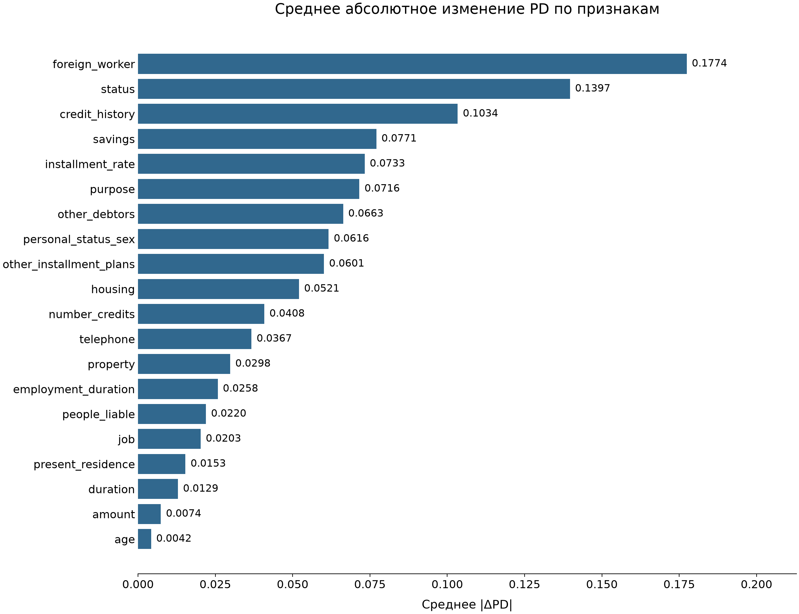
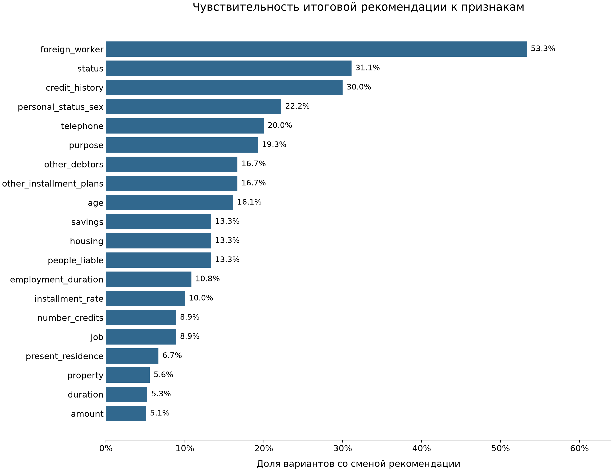
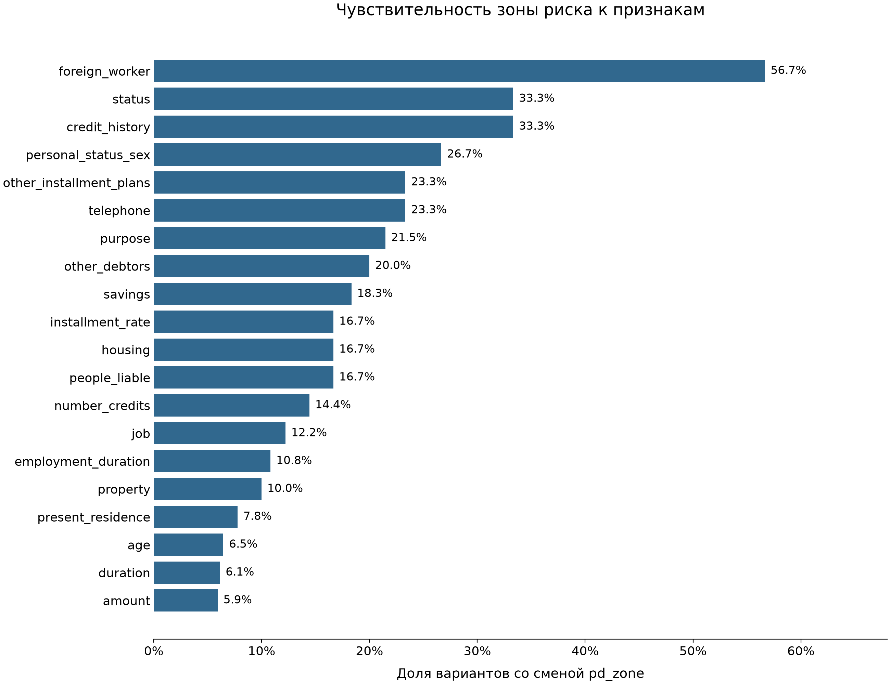

# Анализ чувствительности кредитного решения к признакам

## Цель

Проверить влияние изменения одного ML-признака при фиксированных остальных на калиброванный PD,
пороговую зону `pd_zone` и автоматическую рекомендацию `recommendation`.

## Методика

Использованы 30 базовых заявок и 1 979 уникальных вариантов. Базы взяты из тестовой
части South German Credit (200 строк; seed разбиения 42).
Выбор включает разные зоны, близость к порогам, возрастам 25/26 и случайные строки с seed 42.
Распределение баз по pd_zone: {"approve": 2, "review": 17, "reject": 11}.

В каждом варианте изменён ровно один признак. Скоринг выполнен через ML API `/predict/batch`.
Для числовых признаков использованы локальные изменения
-20%, -10%, +10%, +20%, округление до int
и ограничение обучающим диапазоном; для age дополнительно — [24, 25, 26, 27].
Для порядковых и категориальных признаков перебраны допустимые значения, кроме исходного.
Совпадающие варианты удалены.

Анализируются calibrated PD, pd_zone и recommendation с reasons. Пороги:
approve при PD < 0.083; review при
0.083 ≤ PD ≤ 0.285; reject при PD > 0.285.
Recommendation получена из API, а не рассчитана по этим порогам.
Среднее |ΔPD| — среднее по вариантам внутри каждой базы, затем среднее по базам.
Доли смены зоны рассчитаны по валидным парам PD; доли смены рекомендации — по успешным парам рекомендаций.

Этот отчёт сформирован только из сохранённых файлов; ML API повторно не вызывался.

## Основные результаты

- Изменений pd_zone: **335** (16.93% всех вариантов).
- Изменений recommendation: **302** (15.26% всех вариантов).
- HTTP/API errors при скоринге вариантов: **0**; ошибок формата ответа: **0**.
- Ошибок API/ответа на этапе отбора баз: **0**.
- Топ по среднему |ΔPD|: `foreign_worker` (0.1774), `status` (0.1397), `credit_history` (0.1034), `savings` (0.0771), `installment_rate` (0.0733).

### Среднее абсолютное изменение PD по признакам

| Место | Признак | Значение |
| --- | --- | --- |
| 1 | foreign_worker | 0.1774 |
| 2 | status | 0.1397 |
| 3 | credit_history | 0.1034 |
| 4 | savings | 0.0771 |
| 5 | installment_rate | 0.0733 |

### Чувствительность итоговой рекомендации к признакам

| Место | Признак | Значение |
| --- | --- | --- |
| 1 | foreign_worker | 53.33% |
| 2 | status | 31.11% |
| 3 | credit_history | 30.00% |
| 4 | personal_status_sex | 22.22% |
| 5 | telephone | 20.00% |

### Чувствительность зоны риска к признакам

| Место | Признак | Значение |
| --- | --- | --- |
| 1 | foreign_worker | 56.67% |
| 2 | status | 33.33% |
| 3 | credit_history | 33.33% |
| 4 | personal_status_sex | 26.67% |
| 5 | other_installment_plans | 23.33% |

Три рейтинга независимы; строки с равными значениями сохраняют исходный порядок CSV.
Числовые значения в таблицах округлены, исходная точность сохранена в CSV.

## Чувствительность PD

Наибольшая чувствительность PD к изменению признака наблюдается для `foreign_worker` (0.1774), `status` (0.1397), `credit_history` (0.1034), `savings` (0.0771), `installment_rate` (0.0733).
Значения выражены в единицах вероятности: например, 0.10 соответствует 10 процентным пунктам PD.
Это чувствительность к выбранному перебору значений, а не feature importance.
Полный перебор категорий и локальные изменения числовых признаков охватывают разный масштаб изменений.

## Чувствительность итогового решения

Зона по PD и итоговая рекомендация измеряются отдельно. Например, для `age`
доля смены pd_zone составляет 6.45%, а доля смены
recommendation — 16.13%.
Малое изменение PD не исключает смены рекомендации при пересечении границы бизнес-правила.
Автоматическая recommendation не является сохранённым решением кредитного специалиста.

## Показательные переходы

### approve->review

Найдено вариантов: 23. Пример `test-121:status:1`:

| feature | base_value | variant_value | base_pd | variant_pd | delta_pd | base_pd_zone | variant_pd_zone | base_recommendation | variant_recommendation | variant_reasons |
| --- | --- | --- | --- | --- | --- | --- | --- | --- | --- | --- |
| status | 4 | 1 | 0.0652 | 0.2035 | 0.1383 | approve | review | approve | review | [] |

### review->reject

Найдено вариантов: 140. Пример `test-709:status:1`:

| feature | base_value | variant_value | base_pd | variant_pd | delta_pd | base_pd_zone | variant_pd_zone | base_recommendation | variant_recommendation | variant_reasons |
| --- | --- | --- | --- | --- | --- | --- | --- | --- | --- | --- |
| status | 4 | 1 | 0.2844 | 0.5928 | 0.3084 | review | reject | review | reject | [] |

### reject->review

Найдено вариантов: 51. Пример `test-284:status:4`:

| feature | base_value | variant_value | base_pd | variant_pd | delta_pd | base_pd_zone | variant_pd_zone | base_recommendation | variant_recommendation | variant_reasons |
| --- | --- | --- | --- | --- | --- | --- | --- | --- | --- | --- |
| status | 1 | 4 | 0.5424 | 0.2445 | -0.2979 | reject | review | reject | review | [] |

### review->approve

Найдено вариантов: 88. Пример `test-4:status:4`:

| feature | base_value | variant_value | base_pd | variant_pd | delta_pd | base_pd_zone | variant_pd_zone | base_recommendation | variant_recommendation | variant_reasons |
| --- | --- | --- | --- | --- | --- | --- | --- | --- | --- | --- |
| status | 1 | 4 | 0.2296 | 0.0752 | -0.1543 | review | approve | review | approve | [] |

## Влияние бизнес-правил

Пример `test-887:status:4`, возраст 25 лет:

| feature | base_value | variant_value | base_pd | variant_pd | delta_pd | base_pd_zone | variant_pd_zone | base_recommendation | variant_recommendation | variant_reasons |
| --- | --- | --- | --- | --- | --- | --- | --- | --- | --- | --- |
| status | 1 | 4 | 0.7152 | 0.4067 | -0.3085 | reject | reject | review | review | [{"code": "YOUNG_APPLICANT_REVIEW", "field": "age"}] |

При `pd_zone=reject` API возвращает `recommendation=review` и причину `YOUNG_APPLICANT_REVIEW`. Итоговая автоматическая рекомендация зависит не только от PD, но и от правил поверх модели.

## Ограничения

- Sensitivity analysis не является causal analysis и не доказывает причинное влияние признаков.
- Изменение одного признака при фиксированных остальных может создавать редкие или нереалистичные комбинации.
- Это не классическая feature importance; ранги зависят от баз и стратегии перебора значений.
- Результаты относятся к текущей модели, preprocessing, thresholds и business rules, зафиксированным в run_metadata.json.
- Выборка невелика и включает базы около порогов; частоты переходов не оценивают частоты в реальном потоке.
- `pd=null` не заменяется нулём и не участвует в числовых дельтах.
- Из выбора baseline исключено строк тестовой выборки с `pd=null`: 2. `test-976`: [{"code": "NUMERIC_OUT_OF_RANGE", "field": "amount"}]; `test-719`: [{"code": "NUMERIC_OUT_OF_RANGE", "field": "duration"}].

## Вывод

- На 30 базовых заявках проверено 1 979 уникальных вариантов с изменением одного признака.
- Наибольшая средняя чувствительность PD наблюдается для `foreign_worker`: 0.1774.
- Количество изменений зоны по PD — 335, итоговой рекомендации — 302.
- Рейтинги чувствительности PD, зоны и рекомендации различаются; общий score не рассчитывался.
- Бизнес-правило для молодых заявителей может сохранить review при зоне reject.
- Выводы описывают текущую модель и выбранную стратегию изменения входов, а не причинное влияние признаков.

Источники: [сводка](sensitivity_summary.csv), [варианты](sensitivity_results.csv),
[базы](baselines.csv), [кейсы](transition_cases.json), [метаданные](run_metadata.json).
